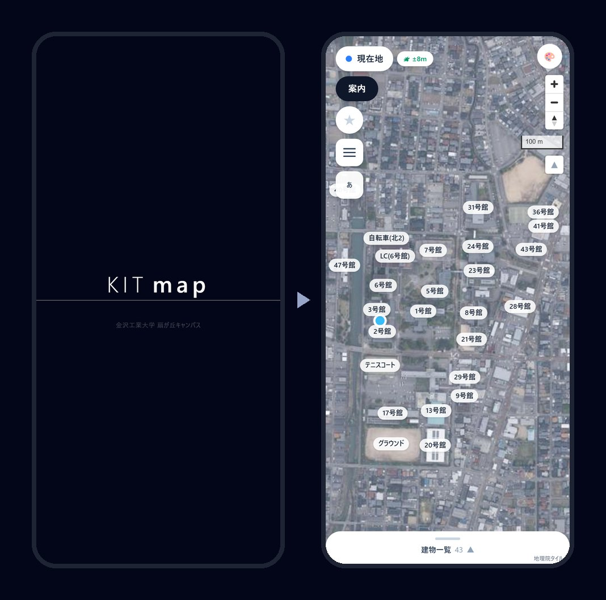

<p align="center">
  <a href="https://kit-map.vercel.app/">
    
  </a>
</p>

<h1 align="center">KIT map</h1>

<p align="center">
  <b>金沢工業大学 扇が丘キャンパスの案内アプリ</b><br>
  「23号館の302、どこ？」に、地図で答えます。
</p>

<h2 align="center">Hackit 2026</h2>
<p align="center">
  🏆 <b>最優秀賞</b>　　🎮 <b>PLAY賞</b><br>
  <sub>テーマ「突破」― 大学の課題を解決するために開発を行った</sub>
</p>

<p align="center">
  <a href="https://kit-map.vercel.app/"><b>アプリを開く</b></a> ・
  <a href="https://hina17ta17.github.io/map-senden/"><b>紹介サイト</b></a> ・
  <a href="https://hina17ta17.github.io/map-senden/#cm"><b>60秒のCM</b></a>
</p>

---

入れるものはありません。ブラウザで開くだけ。地図の名前を押せば出発地と目的地が決まり、
距離と歩いて何分かが出ます。建物の中を通る／通らないも選べます。

> **個人で作ったものです。大学の公式アプリではありません。**
> 大学のドメインなどは設定として外から入れる作りにしてあり、この置き場には書いていません。

## 🏆 受賞

**2026年8月3日、Hackit 2026** で、KIT map は次の 2 つの賞をいただきました。
大会のテーマは **「突破」**。「23号館の302、どこ？」のようにキャンパスの中で迷ってしまう、という大学の課題を解決するために開発しました。
8月1日から3日間で作ったものです（下の「開発の歩み」）。

- 🏆 **最優秀賞**
- 🎮 **PLAY賞**

---

## 画面

<p align="center">
  
</p>

<p align="center">
  左から　<b>道案内</b>（1号館 → 13号館、徒歩5分・333m）　／　<b>建物一覧とお気に入り</b>　／　<b>暗い表示</b>
</p>

地図と建物一覧、道案内は**ログインなしで**そのまま触れます。
学内の情報（食堂・時間割・空き教室・課外活動・ニュース）は、学生・教職員として承認された人だけに出ます。

## デモ

<table>
  <tr>
    <td align="center" width="33%">
      <br>
      <b>道案内</b><br>
      名前を2つ押すだけ。<br>距離と歩く時間が出る
    </td>
    <td align="center" width="33%">
      <br>
      <b>お気に入り</b><br>
      ★を付けた場所が<br>建物一覧のいちばん上に
    </td>
    <td align="center" width="33%">
      <br>
      <b>表示の変更</b><br>
      名前の色・暗い表示・<br>建物の呼び方の付け替え
    </td>
  </tr>
</table>

<sub>どれも実際のアプリを録画したものです。ログイン中に右上に出るメールアドレスの札は、覆ってあります。</sub>

## できること

<p align="center">
  
</p>

| | |
|---|---|
| **道案内** | 地図の名前をふたつ押すだけ。現在地からそのまま案内もできる |
| **中を通る／通らない** | 建物の中を抜ける道すじと、外を回る道すじを選べる |
| **お気に入り** | よく行く場所に★を付けると、入力欄と建物一覧のいちばん上に出る |
| **呼び方を変えられる** | 「41号館」を自分の呼び方（たとえば「夢考房」）に付け替えると、地図にも一覧にもその名前で出る |
| **学内の情報** | その日の食堂のメニュー・時間割・空いている教室・課外活動の予定（承認された学生・教職員だけ） |
| **日本語／English** | 画面の文字も、建物の名前も切り替わる |

<p align="center">
  
</p>

## 紹介サイトとCM

<p align="center">
  <a href="https://hina17ta17.github.io/map-senden/">
    
  </a>
</p>

**https://hina17ta17.github.io/map-senden/**

作ったものを 60 秒にまとめた CM を置いてあります。
押した人にだけ流れます（開いただけでは動画を読み込みません）。

---

## 開発の歩み

**8月1日〜3日の3日間（44回の記録）で作り、8月3日に Hackit 2026 で最優秀賞・PLAY賞をいただきました。**
そのあと11月まで作り込みを続け、記録は全部でおよそ200回になりました。

| 時点 | 建物 | 歩ける点 | つながり |
|---|---:|---:|---:|
| 8月1日の夜 | 40 | 98 | 147 |
| **8月3日（受賞のとき）** | 42 | 648 | 729 |
| いま | 43 | 4,177 | 4,414 |

### 役割

| 役割 | だれが |
|---|---|
| 学内の情報・教室の情報を集めて整理する | チームのメンバー |
| 作図ツール・地図データ・画面・データベース・守り（この置き場のコード） | hina17ta17 |
| 不具合が無いかを試す | チームのメンバー全員 |
| 実際に使って、悪い所・ほしい機能を出す | メンターの方々 |

### 8月1日 ― 情報を集め、作図ツールで地図を作る（2回）

**チームのメンバーで、学内の情報（学部・学科・課外活動など）と教室の情報を集めて整理し、** そのあいだに地図を作りました。
地図サービスは構内の通路を知らないので、**まず地図そのものを自分で作る道具**から作りました。

- **作図ツール**（MapLibre GL JS の上に、地理院の航空写真を敷いたもの。約2,600行）
  - 敷地の輪郭を描く（1面・18頂点）
  - 国の **基盤地図情報（XML）から建物の形を取り込み**、航空写真と見比べて建物・屋外を描く（38件）
  - 一つずつ名前と種類（号館・施設・屋外など）を付ける（38/38）
  - 描いたものはブラウザに自動で保存し、区切りごとに GeoJSON として書き出す
- 夜：**歩ける点（チェックポイント）とつながり**を置く機能を足し、**地図の第一版を完成**させる（点 98・つながり 147）。
  建物の出入口・交差点・曲がり角・門に点を置き、点を順に押すだけで数珠つなぎに道を引ける。
  「すべての点がひと続きにつながっているか」を、ツールがその場で確かめて赤／緑で知らせる
- 部屋（教室）を入力する欄と、データの点検の道具

### 8月2日 ― 第一版の完成、全員で試し、使ってもらいながら作り込む（30回）

朝のうちに、作図ツールを `/edit` へ移し、`/` を**使う人のための案内の画面**にして、KIT map の第一版ができました。
そこからの進め方は次のとおりです。この日だけで30回記録しています。

1. **チームのメンバー全員で、不具合が無いかを試す**
2. そこからは**アジャイルで回す**：短く作る → 使ってもらう → 直す・足す → また使ってもらう
3. **メンターの方々にも積極的に使ってもらい**、悪い所とほしい機能を聞いて、その場で直す・足す

この日に入ったものは、次のとおりです。

- **道案内**：自分で引いた網の上で、いちばん短い道すじを出す（`lib/route.ts`）。目的地は赤いピン、着いたら大きく知らせる
- **建物一覧**：画面の下から引き出す形。建物を押すとそこへ寄り、もう一度押すと元の見え方に戻る
- **現在地**：向きと、いま何で測っているか（衛星か、おおまかか）を出す。iPhone の Safari で始まらない不具合も、この日に直した
- 建物の名前が重ならないように並べる。ページごと拡大されてしまうのを止める
- **ログインの土台**（Supabase）と、ログインした人だけに出す**学内の情報**の画面（食堂・時間割・学科と課外活動）
- **管理の画面**：教室をまとめて登録（号館ごと・全号館）、予定の登録（授業・イベント・課外活動）。使われている教室は選べない。
  食堂の担当（管理者レベル0）の設定画面と、権限ごとにボタンを出し分ける仕組み

### 8月3日 ― 仕上げて、受賞（12回）

- 地図のデータを**描き直したもの**に入れ替える（点 98 → **648**、つながり 147 → **729**、建物 42）
- **出入口の組み合わせをすべて見比べて**、いちばん短い道を選ぶ（いちばん近い出入口が、道なりでも近いとはかぎらないため）
- **地図の名前を2つ押すだけで道案内が始まる**。どの案内でも到着を知らせ、目的地の階を目立たせる
- **お気に入り（★）**、建物一覧の「施設」「その他」の区切り、起動したときに構内がひととおり入る見え方
- **英語への切り替え**、拡大縮小のときに固まる不具合の修正

**受賞のときにあった機能**：航空写真の地図と建物の名前・建物一覧・お気に入り・名前を押すだけの道案内（出入口の組み合わせから最短）・到着の知らせ・現在地・日本語と英語・ログインと学内の情報（食堂・時間割・課外活動）・管理の画面（教室・予定・食堂）。

### 受賞のあとに足したこと

| 時期 | 足した機能・直したこと |
|---|---|
| 8月8日〜31日 | **申請と承認**（本人確認つき。承認の画面は新規／既存に分ける）、**認証アプリの6桁**（知らない端末から入るときにも確かめる）。<br>**表示の変更**（名前の色・暗い表示・建物の呼び方の付け替え）、パスワードの入れ直し、ログインと申請の英語化。<br>作図ツールを公開サイトから外して手元だけの道具に。地図の操作が重い原因を3つ直す |
| 9月1日〜2日 | **道の網を完成**（点 4,177・つながり 4,414・すべてひと続き）、**建物の中を通らない道すじ**、道すじが途中を飛ばす不具合の修正。<br>拡大縮小を滑らかに（指で動かしている間は描く細かさを下げる）。管理者の段を増やし、感想を受け取れるように。<br>**名簿の画面**（自前の xlsx で取り込む） |
| 9月3日〜9日 | 名簿の書き出し、ドメイン名の確認、**操作の履歴**、カレンダーの祝日、**kit-agent**（申請を名簿と突き合わせて自動で判断する）とその様子の画面、教職課程・課外活動リーダーの申請、食堂の写真、**ニュース** |
| 9月10日〜30日 | 課外活動の情報、**道の探し方を二分ヒープにして 4〜5倍速く**、付け替えた名前でも建物を探せるように、ニュースの帯・写真の差し替え |
| 10月 | **守りの総点検**：公開できる形への掃除、攻撃の検査（エージェントガード）、守りの見出し（HTTP ヘッダ）、部品の脆弱性の修正、データベースの決まりの見直し（SQL 39本を5本にまとめ直す）、ニュースの期間をあとから変えられるように。<br>**サイトの緊急停止**、管理の画面をサーバーで確かめてから送る、ログインしていない人への許可を絞る |
| 11月 | 公開の準備：この説明、試験（46件）、書き方の検査の誤り 0、使ってよい条件。<br>**アクセス解析**（クッキーを使わない形。管理の画面と、URL の `?` から後ろは送らない） |

> **この置き場の記録（履歴）について**
> 開発に使った非公開の置き場から、**データベースの定義・鍵・個人の情報を抜いて移した**ものです。
> コード・日付・記録の説明文は元のままです（記録の番号は変わっています）。
> データベース・鍵の例・大学の資料の取り込みだけを変えた回は、中身が空になるので入っていません。
> そのため、ここに並ぶ記録の数は、上に書いた数（たとえば8月2日の30回）より少し少なくなっています。
> 8月の記録に入っている作図ツールは、8月27日に手元だけの道具へ移したものです。

---

## 何で作っているか

| | |
|---|---|
| 画面 | Next.js 16（App Router）／ React 19 ／ TypeScript 5 ／ Tailwind CSS 4 |
| 地図 | MapLibre GL JS 6（BSD-3-Clause）＋ 国土地理院タイル（出典表示が義務） |
| 裏側 | Supabase（PostgreSQL・東京）／ RLS ＋ `security definer` 関数 ／ PostgREST の RPC |
| 認証 | メール＋パスワード ＋ TOTP の二要素（認証アプリ） |
| 自動化 | 申請の自動承認を、データベースの関数で（kit-agent） |
| 置き場 | Vercel（画面。関数は東京 `hnd1`）／ Supabase（データ） |
| 解析 | Vercel Web Analytics（クッキーなし。送る前に `?` から後ろを消し、管理の画面は数えない：`lib/analytics.ts`） |

画面のコードはおよそ **3万2千行**（TypeScript）。
このほかに、データベースの定義（SQL およそ9千行）と、手元だけで使う作図ツールや点検の道具があります。
どちらも公開していません（下の「ここに入れていないもの」）。

---

## 中でやっていること

### 1. 道案内を、地図サービスに頼らずに作った

Google Directions API は**構内の通路も教室も知りません**。使えないので、自前で作りました。

- 航空写真の上に、歩ける地点 **4,177個**と、そのつながり **4,414本**を打った
- そこを**ダイクストラ法＋二分ヒープ**で解く（`lib/route.ts`）
- 最初は全部を見比べる作りで 4.6ms かかっていたものを、ヒープと「目的地に着いたら止める」で **1.0ms** に
- 建物の出入口を通らないと中へ入れないようにして、「壁を突き抜ける道すじ」を出さない

### 2. 安全の線を、画面ではなくデータベースに引いた

画面のコードは誰でも読めます。だから「見せない」ではなく「**触らせない**」で守っています。

- 表は 32 個すべて **RLS（行ごとの決まり）を有効**にしている。
  名簿・ニュース・操作の履歴など 9 個は決まりを一つも置かず、確かめを入れた `security definer` の関数からだけ触れる
- ログインしていない人に開いているのは、**感想を送ること**と**サイトの様子を訊くこと**だけ。
  これから作る表や関数も、初めは閉じた状態で生まれる
- 権限は7段階（学生・教職員／食堂の担当／課外活動リーダー／教授／副管理者2.1・2.2／管理者）
- 管理の権限は、そのログインで**認証アプリの6桁を確かめるまで効かない**（データベースが `aal2` を見る）
- 管理の画面は、**送る前にサーバーで権限を確かめる**。URL を知っていても、権限が無ければ中身は届かない
- **緊急停止**：管理者が押すと、管理者以外はどの画面もメンテナンス中になり、データベースも入口で断る。もう一度押すと戻る
- その決まりが本当に効いているかは、手元にデータベースを立てて**実際に叩いて確かめた**
  （権限ごとに本当に読み書きできないか、6桁の前に本当に止まるか）。この試験はデータベースの定義と一緒に非公開

#### 誰が何を読める・書けるか（早見表）

データベースの定義そのものは公開していませんが、決まりの中身はこのとおりです。
「承認された人」は学生・教職員以上（承認待ちは含まない）。

| データ | 読める | 書ける |
|---|---|---|
| 地図・建物・道の網 | 誰でも（ただのファイル） | —（作図ツールで作って置く） |
| 自分の利用者の情報 | 本人 | 本人（承認の前は申請の項目だけ） |
| ほかの人の利用者の情報・権限 | 副管理者2.2・管理者 | 副管理者2.2・管理者（いちばん上の権限は画面からは付けられない） |
| 食堂のメニュー・営業 | 承認された人 | 食堂の担当・副管理者・管理者 |
| 時間割・予定 | 承認された人 | 課外活動リーダー・教授・副管理者・管理者（直す・消すのは、入れた本人か副管理者以上） |
| 教室・学部・学科・時限 | 承認された人 | 副管理者・管理者 |
| 課外活動の一覧 | 承認された人 | 副管理者2.2・管理者 |
| ニュース | 承認された人（関数から） | 出す：食堂の担当〜管理者／載せてよいかの承認：副管理者2.2・管理者 |
| 名簿 | 教授（見るだけ）・副管理者・管理者（関数から） | 副管理者・管理者 |
| 感想 | 教授・副管理者・管理者 | 送る：誰でも（ログインしなくても） |
| 操作の履歴 | 副管理者・管理者（関数から） | 操作のたびに自動で残る |
| サイトの緊急停止 | 誰でも（止まっているかだけ） | 管理者（6桁を確かめたログインのときだけ） |

### 3. 申請の承認を、人の手から外した

登録の申請が来るたびに人が名簿と突き合わせるのは続きません。
**kit-agent** が、申請が出そろった瞬間に判断します。

- 本体はデータベースの中の関数。常駐する番組ではない
- ドメイン・学籍番号・氏名・学年・クラスを名簿と突き合わせ、**通す／はじく／人に回す**を決める
- 判断できないものは必ず人に回す（間違って通すより、止めるほうを選ぶ）
- 働きぶりを見る画面もある（`/admin/agent`。学年・学科・クラス・身分で絞って追える）

### 4. 外部ライブラリを入れずに書いたもの

- **xlsx の読み書き**（`lib/xlsx.ts`）
  … 広く使われている SheetJS は、npm に出ている版に未修正の脆弱性が2件あります。
  名簿を読むために直せない穴を抱えるのは割に合わないので、必要な範囲だけ自分で書きました
- **多言語の切り替え**・**祝日の計算**・**基盤地図情報（XML）の取り込み**・**写真の縮小**

### 5. 速さと通信量

- 地図データ 3.9MB は、Brotli 圧縮で **226KB** になって届く
- はじめて開いたときの通信は **805KB**。二度目以降は ETag で 304（本文が流れない）
- 位置の追従は、揺れを捨てて 2m 以上動いたときだけ受け取る（指の操作に割り込ませない）

---

## 画面の一覧

| URL | 中身 | 誰が |
|---|---|---|
| `/` | 地図と案内。建物一覧・お気に入り・表示の変更・学内の情報 | 誰でも（学内の情報は承認された人） |
| `/login` | 申請・ログイン・二要素認証・パスワードの入れ直し | 誰でも |
| `/admin` | 承認と権限、ニュースの承認、緊急停止 | 副管理者2.2・管理者（緊急停止は管理者だけ） |
| `/admin/news` | ニュースの登録（写真はあとから差し替えられる） | 食堂の担当・課外活動リーダー・教授・副管理者・管理者 |
| `/admin/schedule`・`/admin/plan` | 課外活動などの予定 | 課外活動リーダー・教授・副管理者・管理者 |
| `/admin/cafeteria` | 食堂のメニューと時間 | 食堂の担当・副管理者・管理者 |
| `/admin/roster`・`/admin/feedback` | 名簿（教授は見るだけ）・届いた感想 | 教授・副管理者・管理者 |
| `/admin/agent` | kit-agent の様子と履歴 | 副管理者・管理者 |
| `/admin/rooms`・`/admin/campus`・`/admin/history` | 教室・学部と学科・操作の履歴 | 副管理者・管理者 |

---

## 動かすには

```bash
npm install
npm run dev        # http://localhost:3000
npm test           # 試験（下の「試験」）
npm run lint       # 書き方の検査
```

地図・建物一覧・道案内は、地図データ（`public/data/`）だけで動きます。

ログイン・学内の情報・管理の画面は、Supabase のデータベースを使います。
**データベースの定義（表・行ごとの決まり・関数の SQL）は、この置き場には入れていません。**
名簿の形や学内の区分など、大学での運用に合わせた中身を含むためです。
守りは定義を見られても破られない作りにしてあり、隠していることには頼っていません
（決まりの中身は、上の「誰が何を読める・書けるか」のとおり）。

環境変数は `.env.local` に置きます（この置き場には入れません）。

```
NEXT_PUBLIC_SUPABASE_URL=https://xxxxxxxx.supabase.co
NEXT_PUBLIC_SUPABASE_ANON_KEY=…        # 画面に入る鍵。外から読めてよい
SUPABASE_SERVICE_ROLE_KEY=…            # ★画面に入れない。サーバ側だけ
NEXT_PUBLIC_ALLOWED_DOMAINS=st.example.ac.jp,example.ac.jp   # 申請できるメールのドメイン
NEXT_PUBLIC_CANONICAL_HOST=…           # 正しいサイトの住所（ほかの住所から来た人をここへ送る）
AGENTGUARD_URL=…                       # 攻撃の検査の送り先（無ければ検査しない）
AGENTGUARD_KEY=…                       # その鍵（無ければ検査しない）
DEV_ALLOWED_ORIGINS=…                  # 開発中にスマホから開くときの、手元の住所（カンマ区切り）
```

`SUPABASE_SERVICE_ROLE_KEY` に `NEXT_PUBLIC_` を付けないでください。
付けると画面に配られ、何でもできる鍵が外から読めてしまいます。

地図データ（`public/data/*.geojson`）は、このまま扇が丘キャンパスのものです。
別の場所で使うときは、作図ツールで描き直します。

---

## 試験

`npm test` で走ります（Vitest。データベースも画面も要らない部分）。

| ファイル | 確かめること |
|---|---|
| `tests/route.test.ts` | 道案内：いちばん短い道を選ぶ・使わない区間や建物の中を外す・出入口が複数あるとき道なりで近い組を選ぶ。<br>本物の地図データで、点 4,177・つながり 4,414・すべてひと続き・速い探し方と素直な探し方が同じ距離を出す |
| `tests/holidays.test.ts` | 祝日：2026年の祝日すべて（振替休日・国民の休日を含む）、春分・秋分が年で動くこと |
| `tests/xlsx.test.ts` | 自前の xlsx：書いて読み戻すと同じ表になる（頭の 0・日本語・記号・複数のシート） |
| `tests/adminAccess.test.ts` | 管理の画面ごとに、入れる権限（9つの権限 × 11の画面） |
| `tests/analytics.test.ts` | アクセス解析に送る前：`?` と `#` から後ろを消す・管理の画面は送らない |
| `tests/session.test.ts` | 全員をログインし直させる仕掛け：初めての人は読み込み直さない・前の版のログインだけ切る・ログアウトできないときに読み込みを繰り返さない |

---

## 置き場の中身

| | |
|---|---|
| `app/`・`components/`・`lib/` | 画面と、その下ごしらえ |
| `public/data/` | 地図データ（GeoJSON） |
| `tests/` | 試験 |
| `assets/readme/` | この説明に載せている写真と動く画像 |
| `scripts/copy-maplibre-worker.mjs` | 組み立ての前に走る下ごしらえ |

### ここに入れていないもの（手元にはあります）

守りのため、または配って動かすのには要らないため、置き場からは外してあります。

| | |
|---|---|
| **データベースの定義** | 表・行ごとの決まり（RLS）・関数の SQL と、その試験。大学での運用に合わせた中身を含むため公開しない |
| **鍵** | `.env.local` の中身。どの版にも入れていない |
| 作図ツール | 地図データを描く画面。`/edit` として手元でだけ動く |
| 診断画面 | 地図が出ないときに、どこで失敗しているかを見る `/test` |
| エージェント（Python） | 申請の割り振り、名簿の取り込み・書き出し |
| 点検の道具 | 権限（RLS）や二要素の確かめが本当に効いているかを試すもの |
| 設計の覚え書き | 仕様・データ構造・作業手順 |

---

## もう一度、置いておきます

- アプリ … **https://kit-map.vercel.app/**
- 紹介サイトと CM … **https://hina17ta17.github.io/map-senden/**

## 使ってよい条件

- **コード**は [MIT](LICENSE) です。作者の表示を残せば、読む・使う・直すのは自由です。
- **地図データ**（`public/data/`）は国土地理院のデータをもとに作っています。使うときは国土地理院の利用規約に従い、下の出典を表示してください。
- MapLibre GL JS（`public/maplibre/`）は、それ自身の BSD-3-Clause です。
- 大学の名前は、この条件の対象外です。

## 出典

- 背景の地図・航空写真 … [**地理院タイル**](https://maps.gsi.go.jp/development/ichiran.html)（国土地理院）
- 建物の形 … **基盤地図情報**（国土地理院）をもとに作成

画面の中の出典表示は、利用条件で義務づけられています。**消さないでください。**
