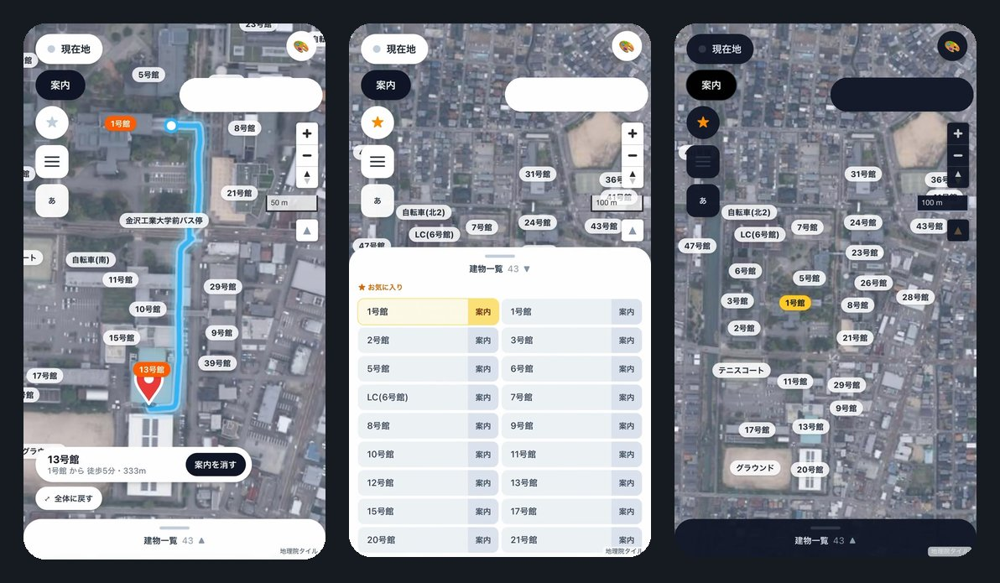
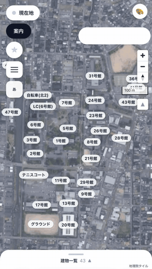
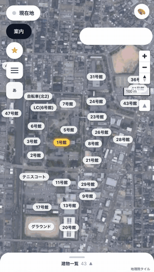
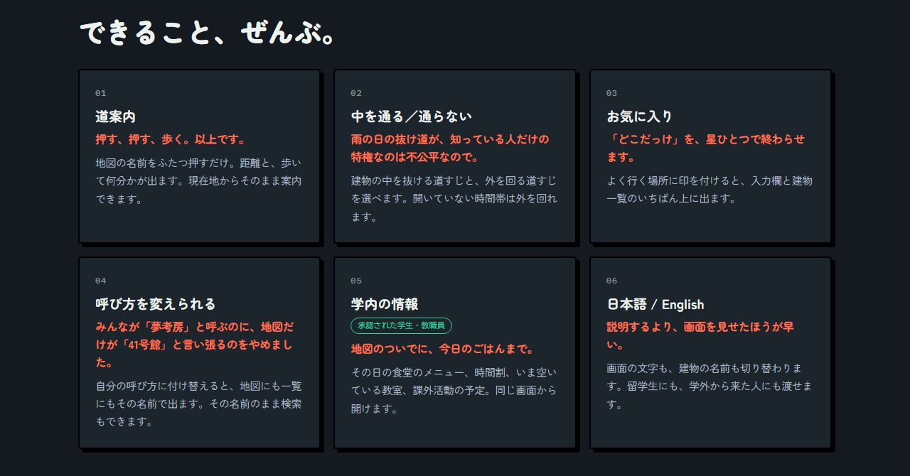

<p align="center">
  <a href="https://hina17ta17.github.io/map-senden/">
    
  </a>
</p>

<h1 align="center">KIT map</h1>

<p align="center">
  <b>金沢工業大学 扇が丘キャンパスの案内アプリ</b><br>
  「23号館の302、どこ？」に、地図で答えます。
</p>

<p align="center">
  🏆 <b>Hackit 2026 最優秀賞</b>　／　🎮 <b>Hackit 2026 PLAY賞</b>
</p>

<p align="center">
  <a href="https://kit-map.vercel.app/"><b>アプリを開く</b></a> ・
  <a href="https://hina17ta17.github.io/map-senden/"><b>紹介サイト</b></a> ・
  <a href="https://hina17ta17.github.io/map-senden/#cm"><b>60秒のCM</b></a>
</p>

---

入れるものはありません。ブラウザで開くだけ。地図の名前を押せば出発地と目的地が決まり、
距離と歩いて何分かが出ます。建物の中を通る／通らないも選べます。

> **個人で作ったものです。大学の公式アプリではありません。**
> 大学のドメインなどは設定として外から入れる作りにしてあり、この置き場には書いていません。

## 🏆 受賞

**Hackit 2026** で、KIT map は次の 2 つの賞をいただきました。

- 🏆 **最優秀賞**
- 🎮 **PLAY賞**

---

## 画面

<p align="center">
  
</p>

<p align="center">
  左から　<b>道案内</b>（1号館 → 13号館、徒歩5分・333m）　／　<b>建物一覧とお気に入り</b>　／　<b>暗い表示</b>
</p>

地図と建物一覧、道案内は**ログインなしで**そのまま触れます。
学内の情報（食堂・時間割・空き教室・課外活動・ニュース）は、学生・教職員として承認された人だけに出ます。

## デモ

<table>
  <tr>
    <td align="center" width="33%">
      <br>
      <b>道案内</b><br>
      名前を2つ押すだけ。<br>距離と歩く時間が出る
    </td>
    <td align="center" width="33%">
      <br>
      <b>お気に入り</b><br>
      ★を付けた場所が<br>建物一覧のいちばん上に
    </td>
    <td align="center" width="33%">
      <br>
      <b>表示の変更</b><br>
      名前の色・暗い表示・<br>建物の呼び方の付け替え
    </td>
  </tr>
</table>

<sub>どれも実際のアプリを録画したものです。ログイン中に右上に出るメールアドレスの札は、覆ってあります。</sub>

## できること

<p align="center">
  
</p>

| | |
|---|---|
| **道案内** | 地図の名前をふたつ押すだけ。現在地からそのまま案内もできる |
| **中を通る／通らない** | 建物の中を抜ける道すじと、外を回る道すじを選べる |
| **お気に入り** | よく行く場所に★を付けると、入力欄と建物一覧のいちばん上に出る |
| **呼び方を変えられる** | 「41号館」を自分の呼び方（たとえば「夢考房」）に付け替えると、地図にも一覧にもその名前で出る |
| **学内の情報** | その日の食堂のメニュー・時間割・空いている教室・課外活動の予定（承認された学生・教職員だけ） |
| **日本語／English** | 画面の文字も、建物の名前も切り替わる |

<p align="center">
  
</p>

## 紹介サイトとCM

**https://hina17ta17.github.io/map-senden/**

作ったものを 60 秒にまとめた CM を置いてあります。
押した人にだけ流れます（開いただけでは動画を読み込みません）。

---

## 何で作っているか

| | |
|---|---|
| 画面 | Next.js 16（App Router）／ React 19 ／ TypeScript 5 ／ Tailwind CSS 4 |
| 地図 | MapLibre GL JS 6（BSD-3-Clause）＋ 国土地理院タイル（出典表示が義務） |
| 裏側 | Supabase（PostgreSQL・東京）／ RLS ＋ `security definer` 関数 ／ PostgREST の RPC |
| 認証 | メール＋パスワード ＋ TOTP の二要素（認証アプリ） |
| 自動化 | 申請の自動承認を、データベースの関数で（kit-agent） |
| 置き場 | Vercel（画面。関数は東京 `hnd1`）／ Supabase（データ） |

この置き場のコードはおよそ **4万2千行**（TypeScript 3万2千・SQL 9千）。
このほかに、手元だけで使う作図ツールや点検の道具があります（下の「ここに入れていないもの」）。

---

## 中でやっていること

### 1. 道案内を、地図サービスに頼らずに作った

Google Directions API は**構内の通路も教室も知りません**。使えないので、自前で作りました。

- 航空写真の上に、歩ける地点 **4,177個**と、そのつながり **4,414本**を打った
- そこを**ダイクストラ法＋二分ヒープ**で解く（`lib/route.ts`）
- 最初は全部を見比べる作りで 4.6ms かかっていたものを、ヒープと「目的地に着いたら止める」で **1.0ms** に
- 建物の出入口を通らないと中へ入れないようにして、「壁を突き抜ける道すじ」を出さない

### 2. 安全の線を、画面ではなくデータベースに引いた

画面のコードは誰でも読めます。だから「見せない」ではなく「**触らせない**」で守っています。

- 表はすべて **RLS を有効**にし、`security definer` の関数を通したときだけ読み書きできる
- ログインしていない人に開いているのは、**感想を送ること**と**サイトの様子を訊くこと**だけ。
  これから作る表や関数も、初めは閉じた状態で生まれる
- 権限は7段階（学生・教職員／食堂の担当／課外活動リーダー／教授／副管理者2.1・2.2／管理者）
- 管理の権限は、そのログインで**認証アプリの6桁を確かめるまで効かない**（データベースが `aal2` を見る）
- 管理の画面は、**送る前にサーバーで権限を確かめる**。URL を知っていても、権限が無ければ中身は届かない
- **緊急停止**：管理者が押すと、管理者以外はどの画面もメンテナンス中になり、データベースも入口で断る。もう一度押すと戻る
- その決まりが本当に効いているかを、**実際に叩いて確かめる試験**を書いた
  （権限ごとに本当に読み書きできないか、6桁の前に本当に止まるか）

### 3. 申請の承認を、人の手から外した

登録の申請が来るたびに人が名簿と突き合わせるのは続きません。
**kit-agent** が、申請が出そろった瞬間に判断します。

- 本体はデータベースの中の関数（`base/03_roster.sql`）。常駐する番組ではない
- ドメイン・学籍番号・氏名・学年・クラスを名簿と突き合わせ、**通す／はじく／人に回す**を決める
- 判断できないものは必ず人に回す（間違って通すより、止めるほうを選ぶ）
- 働きぶりを見る画面もある（`/admin/agent`。学年・学科・クラス・身分で絞って追える）

### 4. 外部ライブラリを入れずに書いたもの

- **xlsx の読み書き**（`lib/xlsx.ts`）
  … 広く使われている SheetJS は、npm に出ている版に未修正の脆弱性が2件あります。
  名簿を読むために直せない穴を抱えるのは割に合わないので、必要な範囲だけ自分で書きました
- **多言語の切り替え**・**祝日の計算**・**基盤地図情報（XML）の取り込み**・**写真の縮小**

### 5. 速さと通信量

- 地図データ 3.9MB は、Brotli 圧縮で **226KB** になって届く
- はじめて開いたときの通信は **805KB**。二度目以降は ETag で 304（本文が流れない）
- 位置の追従は、揺れを捨てて 2m 以上動いたときだけ受け取る（指の操作に割り込ませない）

---

## 画面の一覧

| URL | 中身 | 誰が |
|---|---|---|
| `/` | 地図と案内。建物一覧・お気に入り・表示の変更・学内の情報 | 誰でも（学内の情報は承認された人） |
| `/login` | 申請・ログイン・二要素認証・パスワードの入れ直し | 誰でも |
| `/admin` | 承認と権限、ニュースの承認、緊急停止 | 副管理者2.2・管理者（緊急停止は管理者だけ） |
| `/admin/news` | ニュースの登録（写真はあとから差し替えられる） | 食堂の担当・課外活動リーダー・教授・副管理者・管理者 |
| `/admin/schedule`・`/admin/plan` | 課外活動などの予定 | 課外活動リーダー・教授・副管理者・管理者 |
| `/admin/cafeteria` | 食堂のメニューと時間 | 食堂の担当・副管理者・管理者 |
| `/admin/roster`・`/admin/feedback` | 名簿（教授は見るだけ）・届いた感想 | 教授・副管理者・管理者 |
| `/admin/agent` | kit-agent の様子と履歴 | 副管理者・管理者 |
| `/admin/rooms`・`/admin/campus`・`/admin/history` | 教室・学部と学科・操作の履歴 | 副管理者・管理者 |

---

## 動かすには

```bash
npm install
npm run dev        # http://localhost:3000
```

データベースを使う機能（ログイン・名簿・ニュース）には Supabase が要ります。

1. Supabase のプロジェクトを作る
2. `base/01_core.sql` → `02` → `03` → `04` → `05` の順に貼って実行する（くわしくは `base/README.md`。
   表・関数の一覧と、なぜそうなっているかの説明は `base/KITmapのデータベース.html`）。
   貼ったあと `base/90_check.sql` を流すと、入ったかどうかを確かめられる
3. 最初の管理者を `base/91_tools.sql` の ② で作り、管理画面（名簿 → ドメイン名確認）で
   学生・教職員の**メールのドメイン**を入れる
   - ドメインを一つも入れていないうちは、どのアドレスでも席を作れる（入れ忘れで誰も入れなくなるのを防ぐため）
4. `.env.local` を置く

```
NEXT_PUBLIC_SUPABASE_URL=https://xxxxxxxx.supabase.co
NEXT_PUBLIC_SUPABASE_ANON_KEY=…        # 画面に入る鍵。外から読めてよい
SUPABASE_SERVICE_ROLE_KEY=…            # ★画面に入れない。サーバ側だけ
```

`SUPABASE_SERVICE_ROLE_KEY` に `NEXT_PUBLIC_` を付けないでください。
付けると画面に配られ、何でもできる鍵が外から読めてしまいます。

地図データ（`public/data/*.geojson`）は、このまま扇が丘キャンパスのものです。
別の場所で使うときは、作図ツールで描き直します。

---

## 置き場の中身

| | |
|---|---|
| `app/`・`components/`・`lib/` | 画面と、その下ごしらえ |
| `base/*.sql` | データベースの定義。表・RLS・関数。テーマごとの 5本（01〜05）を**番号の順に流す** |
| `public/data/` | 地図データ（GeoJSON） |
| `assets/readme/` | この説明に載せている写真と動く画像 |
| `scripts/copy-maplibre-worker.mjs` | 組み立ての前に走る下ごしらえ |

### ここに入れていないもの（手元にはあります）

配って動かすのには要らないので、置き場からは外してあります。

| | |
|---|---|
| 作図ツール | 地図データを描く画面。`/edit` として手元でだけ動く |
| 診断画面 | 地図が出ないときに、どこで失敗しているかを見る `/test` |
| エージェント（Python） | 申請の割り振り、名簿の取り込み・書き出し |
| 点検の道具 | 権限（RLS）や二要素の確かめが本当に効いているかを試すもの |
| 設計の覚え書き | 仕様・データ構造・作業手順 |

---

## もう一度、置いておきます

- アプリ … **https://kit-map.vercel.app/**
- 紹介サイトと CM … **https://hina17ta17.github.io/map-senden/**

## 出典

- 背景の地図・航空写真 … [**地理院タイル**](https://maps.gsi.go.jp/development/ichiran.html)（国土地理院）
- 建物の形 … **基盤地図情報**（国土地理院）をもとに作成

画面の中の出典表示は、利用条件で義務づけられています。**消さないでください。**
